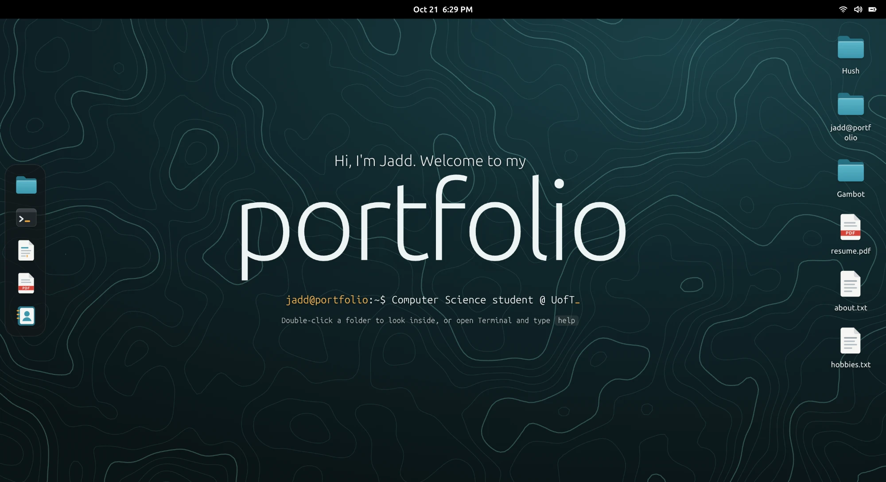

# jadd@portfolio

My portfolio, built as a Linux desktop you can poke around in: draggable windows, a dock,
a file manager, and a terminal that actually runs commands.

**Live at [jaddboi.com](https://jaddboi.com)**



## What's in it

- **Window manager** — drag, resize, focus, stack, minimise, maximise, and a close animation.
  Every change goes through one reducer; the focused window is derived from the window list
  rather than stored, so it can't disagree with what's on screen.
- **Files** — a file manager over a pretend filesystem, with back/forward history, places,
  breadcrumbs, and a banner for project folders.
- **Terminal** — 18 commands (`help`, `neofetch`, `projects`, `skills`, `ls`, `cd`, `open`,
  `theme`…), tab completion, command history, and `Ctrl+L` / `Ctrl+C`.
- **Text Editor, Image Viewer, Document Viewer, Contacts** — the rest of the apps, including
  my resume drawn from the same data that generates everything else.
- **A boot log** on load, a notification banner, and a system menu with a dark/light toggle.

The filesystem, the desktop icons, the terminal's output and the resume all come from one
file, `src/data.js`. Adding a project there gives it a folder, a desktop icon, a README, a
terminal entry and a resume line without touching any other code.

Apart from two project screenshots, the site ships no image files: the contour-map wallpaper
is generated on a canvas from seeded noise and marching squares, and every icon is SVG.

## Built with

React 19 and Vite, with no UI or styling libraries — about 4,000 lines of JavaScript and CSS.
Plain CSS files per component, CSS custom properties for theming.

## Running it

```sh
npm install
npm run dev      # development server, updates as you save
npm run build    # production build into dist/
npm run preview  # serve the production build
```

## Layout

```
index.html           the page; React fills in #root
src/
  main.jsx           entry point
  App.jsx            assembles the screen, maps apps to components
  data.js            all my content: profile, projects, hobbies, skills, resume
  fs.js              the pretend filesystem, built from data.js
  system/            shared state: the window reducer, the app registry, storage
  shell/             the desktop itself: top bar, dock, windows, wallpaper, boot screen
  apps/              what lives inside windows: Files, Terminal, editors, viewers
  shared/            icons, links, the contour drawing
public/              copied as-is: favicon, resume PDF, project screenshots
```

## Deploying

A GitHub Actions workflow builds the site and publishes it to GitHub Pages on every push to
`main`. `vite.config.js` sets `base: './'` and paths in `data.js` go through
`import.meta.env.BASE_URL`, so the build works from a custom domain or a repository sub-path.

## Notes

Keyboard navigation, ARIA roles and labels, light and dark themes, a phone layout (windows go
full screen, the dock moves to the bottom, one tap opens things), and reduced-motion support
throughout.
